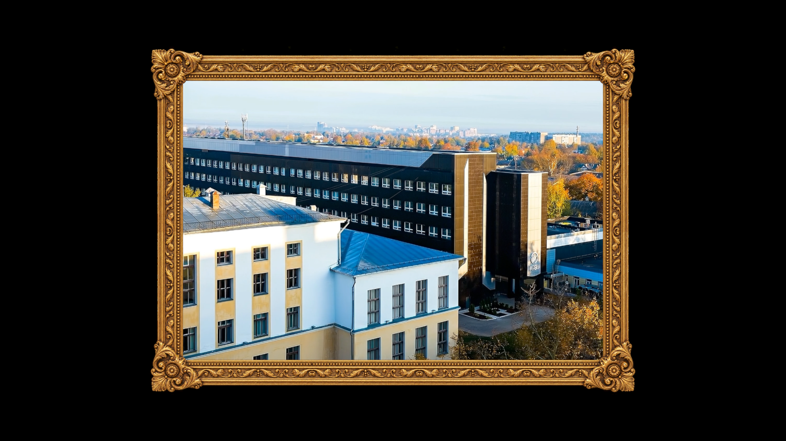
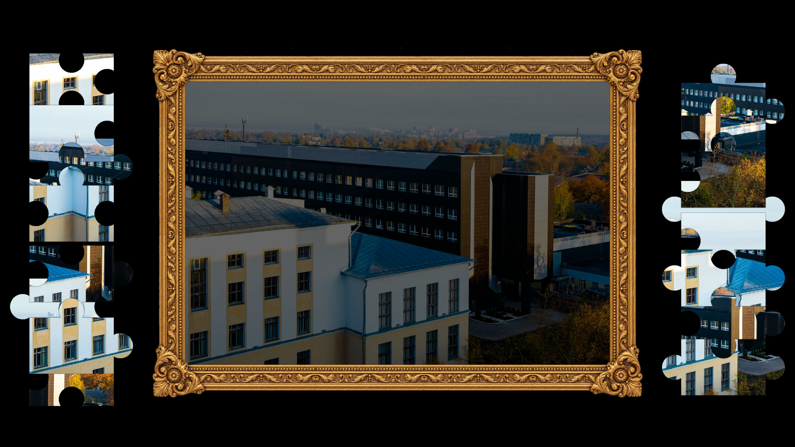
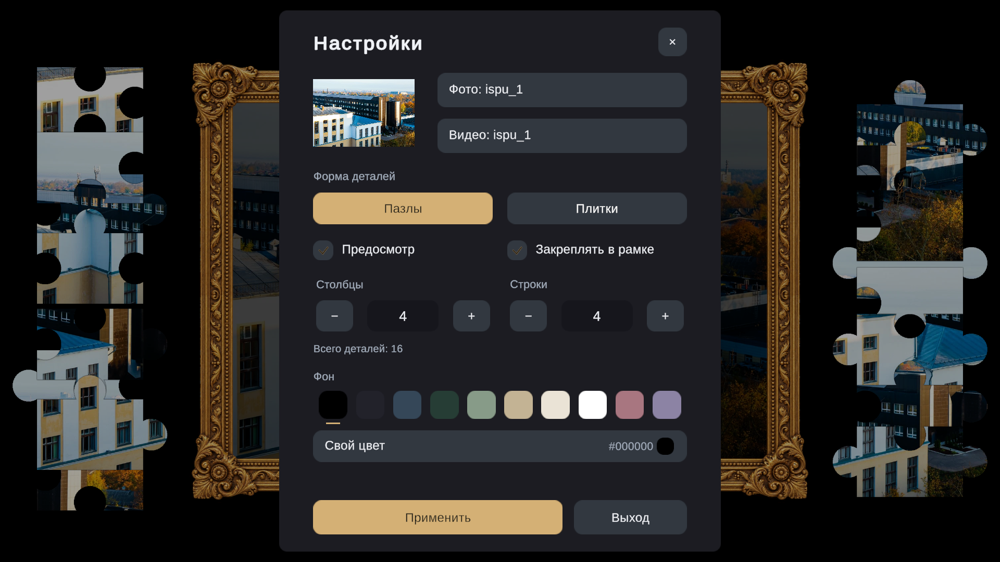

<div align="center">

# TileVerse

### Соберите картину. Посмотрите, как она оживает.

Пазл из ваших фотографий с видео внутри картинной рамки.


[Возможности](#возможности) · [Что изменилось](#что-изменилось) · [Управление](#управление) · [Запуск проекта](#запуск-проекта) · [Для разработчиков](#для-разработчиков)



*Кадр видео после завершения пазла с фотографией ispu_1.*

</div>

## О проекте

**TileVerse** — приложение для сборки пазлов на Unity. Выбранная фотография становится картиной в декоративной рамке, а её фрагменты располагаются по сторонам. Детали можно соединять в небольшие группы, переносить вместе и постепенно собирать изображение.

Когда все детали соединены и установлены в рамку, изображение становится цельным, а внутри той же рамки плавно появляется выбранное видео. Так обычный пазл превращается в оживающую картину.

При запуске уже доступны фотография **ispu_1** и соответствующее видео. Чтобы собрать свой пазл, достаточно открыть настройки клавишей **Esc** и выбрать другие файлы.

<table>
  <tr>
    <td width="50%" align="center">
      <a href="docs/images/gameplay.png"></a>
      <br><b>Сборка картины</b>
    </td>
    <td width="50%" align="center">
      <a href="docs/images/settings.png"></a>
      <br><b>Все настройки в одном окне</b>
    </td>
  </tr>
</table>

## Возможности

### 🧩 Пазлы и сборка

- **Два вида деталей:** классические пазлы со случайными выступами и выемками или плитки с прямыми сторонами. Пропорции плиток зависят от фотографии и сетки.
- **Настраиваемая сложность:** от 2 до 8 строк и столбцов независимо — от **4 до 64 деталей**, включая прямоугольные сетки.
- **Соединение в группы:** соседние детали стыкуются при точном сближении. Собранный фрагмент переносится целиком за любую его деталь.
- **Сборка рядом с рамкой:** можно сначала соединить фрагменты вне картины, затем перенести их на место.
- **Выделение при наведении:** отдельная деталь увеличивается для удобного выбора; соединённая группа увеличивается равномерно, сохраняя стыки.
- **Свободное перетаскивание:** детали и группы следуют за точкой захвата, в том числе у края экрана. Частично видимые фрагменты остаются там, где их отпустили; полностью скрывшиеся возвращаются краем в доступную область.
- **Настраиваемое закрепление:** правильно установленные в рамке фрагменты можно закреплять или оставлять подвижными до завершения сборки.

### 🖼️ Картина и видео

- **Адаптивная рамка** подстраивается под пропорции фотографии и доступное место в окне. Поддерживаются горизонтальные, вертикальные и квадратные изображения.
- **Цельное оформление:** золотой орнамент без дополнительных цветных подложек; углы сохраняют пропорции, а узор на длинных сторонах повторяется без растягивания.
- **Отключаемый предпросмотр:** полупрозрачная фотография помогает при сборке. Если отключить подсказку, внутри рамки остаётся выбранный фон.
- **Видео после завершения:** появляется плавно, заполняет область фотографии и сохраняет пропорции. При несовпадении форматов края видео обрезаются по центру.
- **Пауза в настройках:** открытие меню приостанавливает ролик, закрытие продолжает воспроизведение.
- **Пазл без видео:** сборка доступна и без ролика. Если видео не выбрано или не удалось загрузить, готовая фотография остаётся видимой с сообщением о состоянии.
- **Изменение размеров окна:** поле перестраивается с сохранением соединённых групп и их размещения относительно картины.

### 🎨 Настройки и оформление

- Крупное центральное окно с выбором фото и видео, миниатюрой изображения и основными параметрами.
- **10 готовых цветов фона**, включая чёрный и белый.
- **Свой цвет:** выбор оттенка, насыщенности и яркости или ввод HEX-кода.
- Изменение сетки кнопками **− / +** или прямым вводом чисел; рядом отображается общее количество деталей.
- Тексты интерфейса на **TextMeshPro** с поддержкой кириллицы.
- Подтверждение перезапуска при смене параметров незавершённого пазла.
- Кнопка **«Выход»** в меню настроек.

## Что изменилось

| Область | Обновление |
| :--- | :--- |
| **Основной сценарий** | Сборка фотографии в картинной рамке с переходом к видео после завершения. |
| **Рамка** | Исправлены пропорции углов, убрана полоса между изображением и рамкой, устранено растягивание орнамента. Удалены лишние подложки и декоративные контуры. |
| **Фото и видео** | Вместо примеров «Горы» и «Поляна» по умолчанию используется пара `ispu_1`. Видео заполняет ту же область, что и фото. |
| **Меню** | Настройки собраны в одно увеличенное окно. Добавлены числовой ввод сетки, палитра, собственный цвет и выход из приложения. Все надписи переведены на TextMeshPro. |
| **Подсказки и сложность** | Добавлены выбор формы деталей, переключатель «Предосмотр» и настройка «Закреплять в рамке». |
| **Соединённые фрагменты** | Сохраняют полный размер вне рамки. Наведение увеличивает группу целиком, сохраняя взаимное положение деталей. |
| **Перетаскивание** | Исправлены скачки при захвате и возврат к рамке после свободного отпускания. Убраны ограничения движения у краёв экрана для групп и одиночных деталей. |
| **Завершение сборки** | Детали сменяются цельной фотографией перед появлением видео. При проблемах с роликом картина остаётся видимой. |

## Управление

| Действие | Управление |
| :--- | :--- |
| Выбрать деталь или соединённый фрагмент | Навести курсор |
| Переместить | Зажать левую кнопку мыши и перетащить |
| Соединить детали | Отпустить рядом с подходящей соседней деталью |
| Установить в рамку | Отпустить рядом с правильной позицией |
| Открыть или закрыть настройки | **Esc** |
| Закрыть выбор собственного цвета | **Esc**; следующее нажатие закрывает настройки |
| Отменить подтверждение перезапуска | **Esc** или кнопка отмены |
| Закрыть приложение | **Esc → Выход** |

Пазл считается завершённым, когда все детали объединены и находятся на своих местах внутри рамки.

## Настройка своего пазла

1. Нажмите **Esc**.
2. Нажмите **«Фото»** и выберите изображение. При выборе новой фотографии видео для неё нужно указать отдельно.
3. При необходимости нажмите **«Видео»** и выберите ролик, который появится после сборки.
4. Выберите **«Пазлы»** или **«Плитки»**, затем задайте число строк и столбцов.
5. Настройте **«Предосмотр»**, **«Закреплять в рамке»** и цвет фона.
6. Нажмите **«Применить»**. Если текущая сборка ещё не завершена, подтвердите её перезапуск.

| Параметр | Когда применяется |
| :--- | :--- |
| Фото, видео, форма деталей, строки и столбцы | После **«Применить»**; меняют текущий пазл и запускают сборку заново |
| Фон, предпросмотр, закрепление в рамке | Сразу, с сохранением текущей сборки |

Закрытие меню отменяет неприменённую смену фото, видео, формы и сетки. Уже изменённые фон, предпросмотр и закрепление остаются активными. Параметры сохраняются при повторном открытии меню в текущем сеансе; сохранение партии между запусками не реализовано.

### Файлы

- **Фото:** PNG, JPG, JPEG.
- **Видео:** диалог выбора предлагает MP4, MOV, WEBM, M4V и AVI. Возможность воспроизведения зависит от кодека и платформы; в проверках используется MP4/H.264.
- Выбор локальных файлов реализован в **Unity Editor** и **Windows Standalone**. Ролик, выбранный через меню, читается по пути к файлу и должен оставаться доступным.

## Запуск проекта

**Окружение:** Unity **6000.3.13f1 (Unity 6.3 LTS)**, Universal Render Pipeline **17.3.0**, Input System **1.19.0**. Версия редактора зафиксирована в [ProjectVersion.txt](ProjectSettings/ProjectVersion.txt), зависимости — в [manifest.json](Packages/manifest.json).

1. Клонируйте репозиторий или скачайте его исходники.
2. В **Unity Hub** выберите **Add → Add project from disk** и укажите корень проекта с папками `Assets`, `Packages` и `ProjectSettings`.
3. Откройте проект в Unity **6000.3.13f1** и дождитесь импорта ресурсов и пакетов.
4. Откройте сцену [SampleScene.unity](Assets/Scenes/SampleScene.unity).
5. Нажмите **Play**. Начнётся пазл `ispu_1` с сеткой **4 × 4** и классическими деталями.

По умолчанию фон чёрный, предпросмотр и закрепление в рамке включены. В редакторе кнопка **«Выход»** завершает Play Mode.

### Сборка для Windows

1. Откройте **File → Build Profiles** и выберите **Windows**.
2. Проверьте, что в список сцен включена `Assets/Scenes/SampleScene.unity`.
3. Нажмите **Build** или **Build And Run** и выберите папку для результата.
4. При передаче сборки сохраняйте вместе исполняемый файл и созданные Unity файлы и папки.

## Для разработчиков

### Структура

```text
TileVerse/
├── Assets/
│   ├── Art/                    # Рамка и графика интерфейса
│   ├── Editor/                 # Подготовка сцены и проверки в Play Mode
│   ├── Resources/              # Встроенные изображения и видео, включая ispu_1
│   ├── Scenes/SampleScene.unity
│   ├── Scripts/Puzzle/         # Логика пазла, настроек и воспроизведения
│   └── TextMesh Pro/           # Шрифты и ресурсы TMP
├── Packages/                  # Зависимости Unity
├── ProjectSettings/           # Настройки проекта и сборки
├── Tests/Fixtures/             # Тестовый ролик, не включаемый в игру
├── docs/images/               # Скриншоты для README
└── README.md
```

| Компонент | Задача |
| :--- | :--- |
| `PuzzleGameController` | Запуск пазла, перетаскивание, стыковка, настройки и завершение сборки |
| `PuzzlePieceGenerator` | Согласованные формы соседних деталей, маски и спрайты |
| `PuzzlePieceGroup` / `PuzzlePieceView` | Соединённые группы, состояние размещения, наведение и события указателя |
| `PuzzleBoardLayout` / `PuzzleFrameView` / `PuzzleOrnateFrameView` | Адаптация картины, боковых областей и декоративной рамки |
| `PuzzleSettingsView` / `PuzzleColorPicker` / `PuzzleThemeView` | Меню, выбор цвета и оформление фона |
| `PuzzleMediaEntry` / `PuzzleCompletionVideo` | Пара фото/видео, подготовка ролика, плавное появление, пауза и обработка ошибок |
| `NativeImagePicker` / `NativeVideoPicker` | Системные диалоги выбора локальных файлов |

Постоянные элементы интерфейса и их связи сохранены в сцене. Детали пазла создаются во время игры. По умолчанию используются [ispu_1.png](Assets/Resources/ispu_1.png) и [ispu_1.mp4](Assets/Resources/ispu_1.mp4).

### Проверка работы

В Unity откройте **Tools → TileVerse → Validate gallery in Play Mode**. Проверка использует сохранённую сцену, выполняет игровые действия и сохраняет отчёт со скриншотами в `Logs/GalleryPreview/`.

Последний проверенный результат — **165 успешных проверок**, **15 октября 2026 года**. Проверены формы деталей, пропорции рамки, настройки, наведение и захват, перемещение групп и одиночных деталей у всех краёв, закрепление, предпросмотр, изменение размера окна, воспроизведение видео и кнопка выхода.

Тестовый ролик описан в [Tests/Fixtures/README.md](Tests/Fixtures/README.md). Папки `Library`, `Temp` и `Logs` исключены из Git; изображения для этой страницы хранятся отдельно в `docs/images/`.

<details>
<summary><b>Пересоздание редактируемой сцены</b></summary>

Команда **Tools → TileVerse → Build editable puzzle gallery scene** пересоздаёт игровую сцену и постоянный интерфейс. Для обычного запуска проекта она не требуется: готовая сцена уже находится в `Assets/Scenes/SampleScene.unity`.

</details>
